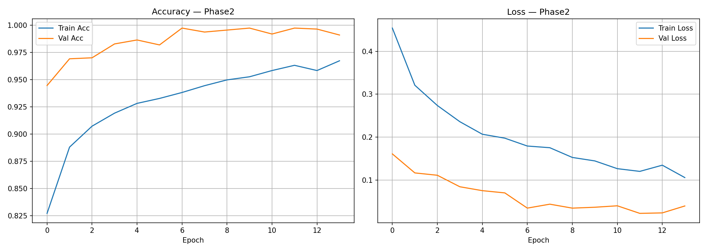

# 🧠 NeuroClear: Explainable Alzheimer's Disease Prediction from MRI

An end-to-end deep learning system that classifies brain MRI scans into **Cognitively Normal (CN)**, **Mild Cognitive Impairment (MCI)**, or **Alzheimer's Disease (AD)** using an **ensemble of three CNNs** (ResNet, DenseNet, EfficientNet), with **Explainable AI** (Grad-CAM, LIME, SHAP) so clinicians can see *why* the model made a prediction.


> ⚠️ **Disclaimer:** This project is for research and educational purposes only. It is **not** a certified medical device and must not be used as a substitute for professional clinical diagnosis.

---

## 📑 Table of Contents

- [Overview](#-overview)
- [Key Features](#-key-features)
- [System Architecture](#-system-architecture)
- [Explainable AI](#-explainable-ai)
- [Project Structure](#-project-structure)
- [Tech Stack](#-tech-stack)
- [Installation](#-installation)
- [Data Preparation](#-data-preparation)
- [Training](#-training)
- [Running the Web App](#-running-the-web-app)
- [Results](#-results)
- [Troubleshooting](#-troubleshooting)
- [Limitations & Future Work](#-limitations--future-work)
- [Acknowledgements](#-acknowledgements)

---

## 🔍 Overview

Alzheimer's disease is a progressive neurodegenerative disorder, and early detection is critical for timely intervention. While deep learning models can detect patterns in MRI scans, they are often treated as "black boxes", which limits clinical trust and adoption.

The models are trained on brain MRI scans from the official [ADNI](https://adni.loni.usc.edu/) dataset, labeled as CN, MCI, or AD.

This project addresses both problems:

1. **Accuracy:** a feature-concatenation ensemble of three complementary CNN backbones (ResNet, DenseNet, EfficientNet) captures diverse imaging features.
2. **Interpretability:** three XAI techniques (Grad-CAM, LIME, SHAP) highlight the brain regions that influenced each prediction.

The trained model is wrapped in a **Flask web application** (NeuroClear) where a user can upload an MRI, enter basic patient details, choose an XAI method, and receive the prediction, class probabilities, and a visual explanation.

---

## ✨ Key Features

- **3-class classification:** CN, MCI, AD
- **Ensemble learning:** ResNet + DenseNet + EfficientNet with a learned fusion head
- **Two-phase training:** fusion head first (backbones frozen), then fine-tuning of the top backbone layers
- **Class-imbalance handling:** balanced sampling and class-weighted cross-entropy loss
- **Three XAI methods:** Grad-CAM, LIME, and SHAP, selectable from the UI
- **Multi-format input:** `.png`, `.jpg`, `.jpeg`, `.nii` (NIfTI), `.dcm` (DICOM)
- **Evaluation suite:** classification report, confusion matrix, per-class ROC/AUC, training curves
- **Web interface:** login, upload, prediction with confidence, and XAI visualization

---

## 🏗 System Architecture

```
                         ┌──────────────┐
                         │  MRI Slice   │  (256 × 256)
                         └──────┬───────┘
                                │
          ┌─────────────────────┼─────────────────────┐
          ▼                     ▼                     ▼
   ┌─────────────┐      ┌──────────────┐      ┌───────────────┐
   │   ResNet    │      │   DenseNet   │      │ EfficientNet  │
   │  (backbone) │      │  (backbone)  │      │  (backbone)   │
   └──────┬──────┘      └──────┬───────┘      └───────┬───────┘
          │   feature vector   │   feature vector     │
          └─────────────────────┼─────────────────────┘
                                ▼
                    ┌───────────────────────┐
                    │ Feature Concatenation │
                    └───────────┬───────────┘
                                ▼
                    ┌───────────────────────┐
                    │  Fusion Head (FC)     │
                    └───────────┬───────────┘
                                ▼
                     CN   |   MCI   |   AD
                                │
                                ▼
                  Grad-CAM · LIME · SHAP explanations
```

The ensemble is implemented as `FeatureConcatEnsemble` in `model/ensemble_model.py`. Rather than averaging three separate predictions, it **concatenates the feature embeddings** from each backbone and trains a fusion classifier on top, which lets the model learn how to weigh each network's evidence.

### Training Strategy

| Phase | What is trained | Learning rate | Max epochs |
|-------|-----------------|---------------|------------|
| **Phase 1** | Fusion head only (backbones frozen) | `1e-3` | 15 |
| **Phase 2** | Fusion head + top 30 backbone layers (fine-tuning) | `1e-4` | 20 |

Shared settings:

- **Optimizer:** Adam
- **Loss:** Cross-entropy with class weights
- **Scheduler:** `ReduceLROnPlateau` (factor 0.5, patience 3)
- **Early stopping:** patience of 7 epochs on validation accuracy
- **Input size:** 256 × 256, batch size 8
- **Sample size:** 11,000 slices (balanced across classes)

---

## 🔬 Explainable AI

Each prediction can be accompanied by a visual explanation. Because the three methods work differently, they offer complementary views.

| Method | How it works | What it shows | Speed |
|--------|--------------|---------------|-------|
| **Grad-CAM** | Uses gradients flowing into the final convolutional layers | A heatmap of regions the network focused on | Fast |
| **LIME** | Perturbs superpixels of the image and fits a local surrogate model | Regions that locally push the prediction toward a class | Medium |
| **SHAP** | Estimates per-pixel Shapley contributions against a background set | Pixel-level positive/negative contributions to the prediction | Slowest (runs on CPU) |

**Why it matters clinically:** a prediction is only useful if a clinician can verify it makes sense. If the highlighted regions correspond to areas known to be affected in Alzheimer's (for example the hippocampus and surrounding medial temporal structures, or ventricular enlargement), confidence in the result increases. If the model focuses on irrelevant areas, that is a red flag.

---

## 📂 Project Structure

```
├── app.py                        # Flask web application
├── train.py                      # Two-phase training + evaluation
├── run_pipeline.py               # Data preprocessing pipeline
├── prepare_shap_background.py    # Builds the SHAP background tensor
├── test_loader.py                # Quick check of the data loader
├── requirements.txt
│
├── dataset/
│   └── loader.py                 # Dataset, balancing, train/val/test split
├── model/
│   └── ensemble_model.py         # FeatureConcatEnsemble (ResNet+DenseNet+EfficientNet)
├── explainability/
│   ├── grad_cam.py               # Grad-CAM implementation
│   ├── lime_explain.py           # LIME implementation
│   └── shap_explain.py           # SHAP implementation
├── src/
│   ├── extract_zips.py           # Unzips raw data
│   ├── merge_csv.py              # Merges metadata CSVs into master.csv
│   └── convert_to_slices.py      # Converts MRI volumes to 2D slices
│
├── templates/                    # HTML templates (index.html, auth.html)
├── static/                       # Logo, uploads, generated XAI images
├── plots/                        # Saved training/evaluation plots
└── models/                       # Trained weights (not tracked, see below)
```

---

## 🛠 Tech Stack

- **Deep learning:** PyTorch, torchvision
- **Explainability:** Grad-CAM, LIME, SHAP
- **Medical imaging:** nibabel (NIfTI), pydicom (DICOM), scikit-image, OpenCV, Pillow
- **Evaluation & plotting:** scikit-learn, matplotlib, seaborn
- **Web app:** Flask

---

## 🚀 Installation

**Prerequisites:** Python 3.10+ and, ideally, a CUDA-capable GPU for training (the web app also runs on CPU).

```bash
# 1. Clone the repository
git clone https://github.com/AnushkaAchavan/Alzheimer-s-disease-prediction-project.git
cd Alzheimer-s-disease-prediction-project

# 2. Create and activate a virtual environment
python -m venv .venv

# Windows (PowerShell)
.venv\Scripts\Activate.ps1
# macOS / Linux
source .venv/bin/activate

# 3. Install dependencies
pip install -r requirements.txt
```

---

## 🗂 Data Preparation

**Dataset:** [ADNI (Alzheimer's Disease Neuroimaging Initiative)](https://adni.loni.usc.edu/), official release. Subjects are grouped into three diagnostic classes: **CN** (Cognitively Normal), **MCI** (Mild Cognitive Impairment), and **AD** (Alzheimer's Disease).

The preprocessing pipeline converts raw MRI volumes and their metadata into a slice-based dataset.

1. Place your raw MRI archives and metadata CSVs in `raw_data/`.
2. Run the pipeline:

```bash
python run_pipeline.py
```

This will:

1. **Merge** all metadata CSVs into `processed_data/metadata/master.csv`
2. **Convert** MRI volumes into 2D slices saved to `processed_data/slices/`
3. **Generate** `processed_data/metadata/final_metadata.csv`, which `train.py` reads

> The MRI dataset itself is **not** included in this repository. This project uses the official **ADNI (Alzheimer's Disease Neuroimaging Initiative)** dataset, which must be obtained separately. Access is free but requires an approved application at [adni.loni.usc.edu](https://adni.loni.usc.edu/data-samples/access-data/) and agreement to the ADNI Data Use Agreement. Raw data and derived data must not be redistributed.

To verify the loader works:

```bash
python test_loader.py
```

---

## 🏋️ Training

```bash
python train.py
```

The script will:

1. Load and balance the dataset, then split into train/validation/test
2. Run **Phase 1** (fusion head with frozen backbones) and save `outputs/best_model_phase1.pth`
3. Run **Phase 2** (fine-tuning the top 30 layers) and save `outputs/best_model_phase2.pth`
4. Evaluate on the test set and generate a classification report, confusion matrix, and ROC curves
5. Save training curves to `outputs/plots/`

Key hyperparameters (`SAMPLE_SIZE`, `BATCH_SIZE`, `IMG_SIZE`, `PHASE1_EPOCHS`, `PHASE2_EPOCHS`) are defined at the top of `train.py`.

---

## 🌐 Running the Web App

### 1. Add the model artifacts

| File | Location | Required for |
|------|----------|--------------|
| Trained weights | `models/best_model_phase2.pth` | Prediction (required) |
| SHAP background tensor | `models/shap_background.pt` | SHAP only |

Copy `outputs/best_model_phase2.pth` from training into `models/`. To generate the SHAP background tensor, run:

```bash
python prepare_shap_background.py
```

You can also point to custom locations with environment variables:

```powershell
# Windows (PowerShell)
$env:ALZHEIMER_MODEL_WEIGHTS="C:\full\path\to\best_model_phase2.pth"
$env:ALZHEIMER_SHAP_BACKGROUND="C:\full\path\to\shap_background.pt"
```

```bash
# macOS / Linux
export ALZHEIMER_MODEL_WEIGHTS=/full/path/to/best_model_phase2.pth
export ALZHEIMER_SHAP_BACKGROUND=/full/path/to/shap_background.pt
```

> Without `shap_background.pt`, Grad-CAM and LIME still work; only SHAP will return an error.

### 2. Start the server

```bash
python app.py
```

Open **http://127.0.0.1:5000** in your browser.

### 3. Use the app

1. Log in (default demo credentials: `admin` / `admin123`)
2. Upload an MRI (`.png`, `.jpg`, `.jpeg`, `.nii`, `.dcm`)
3. Enter the patient's **age** and **gender**
4. Choose an XAI method: **Grad-CAM**, **LIME**, or **SHAP**
5. View the predicted class, confidence, per-class probabilities, and the explanation

> 🔐 The default login is for local demos only. Change it before any shared or production deployment. Registered users are stored **in memory** and are lost when the app restarts.

### API Output

For each request the backend returns:

- Predicted class (`CN` / `MCI` / `AD`) and confidence
- Probabilities for `cn`, `mci`, `ad`
- XAI method used, explanation text, and visualization image URL

---

## 📊 Results

> Fill in these tables with your final test-set numbers from `train.py`.

**Overall performance**

| Metric | Value |
|--------|-------|
| Test accuracy | _TBD_ |
| Macro F1-score | _TBD_ |

**Per-class performance**

| Class | Precision | Recall | F1-score | AUC |
|-------|-----------|--------|----------|-----|
| CN | _TBD_ | _TBD_ | _TBD_ | _TBD_ |
| MCI | _TBD_ | _TBD_ | _TBD_ | _TBD_ |
| AD | _TBD_ | _TBD_ | _TBD_ | _TBD_ |

**Suggested figures** (save into `plots/` and link here):

```markdown



```

---

## 🩹 Troubleshooting

| Problem | Fix |
|---------|-----|
| "Model weights not found" | Check that `models/best_model_phase2.pth` exists, or set `ALZHEIMER_MODEL_WEIGHTS` |
| SHAP fails | Add `models/shap_background.pt` or run `prepare_shap_background.py` |
| State dict fails to load | The `.pth` file was trained with a different architecture than `ensemble_model.py` |
| Import errors | Reinstall dependencies inside the active virtual environment |
| SHAP is very slow | Expected: it runs on CPU and is the most compute-heavy method; use Grad-CAM for quick checks |

---

## ⚠️ Limitations & Future Work

**Current limitations**

- Operates on **2D slices**, not full 3D volumes, so spatial context across slices is not modeled
- Slice-level splitting can cause **data leakage** if slices from the same patient appear in multiple splits; split by patient where possible
- MCI is inherently the hardest class to separate from CN and AD
- Not clinically validated; XAI heatmaps indicate model attention, not causal evidence

**Future work**

- 3D CNN or slice-aggregation approaches for patient-level prediction
- Patient-level train/test splitting and external validation on an independent cohort
- Incorporating clinical features (age, gender, cognitive scores) into the model
- Quantitative evaluation of XAI faithfulness and agreement with known anatomical regions
- Persistent user database and role-based access for the web app
- Docker image for easy deployment

---

## 🙏 Acknowledgements

- This repository is a fork of [anshupriya11929/Alzheimer-s-disease-prediction-project](https://github.com/anshupriya11929/Alzheimer-s-disease-prediction-project). Thanks to the original authors.
- Built with [PyTorch](https://pytorch.org/), [SHAP](https://github.com/shap/shap), [LIME](https://github.com/marcotcr/lime), and [Flask](https://flask.palletsprojects.com/).
- Data used in this project were obtained from the [Alzheimer's Disease Neuroimaging Initiative (ADNI)](https://adni.loni.usc.edu/) database. ADNI investigators contributed to the design and implementation of ADNI and/or provided data but did not participate in the analysis or writing of this work. A complete listing of ADNI investigators is available at [adni.loni.usc.edu/wp-content/uploads/how_to_apply/ADNI_Acknowledgement_List.pdf](https://adni.loni.usc.edu/wp-content/uploads/how_to_apply/ADNI_Acknowledgement_List.pdf).

---

## 📄 License

Add a license of your choice (e.g. MIT) and link it here.
